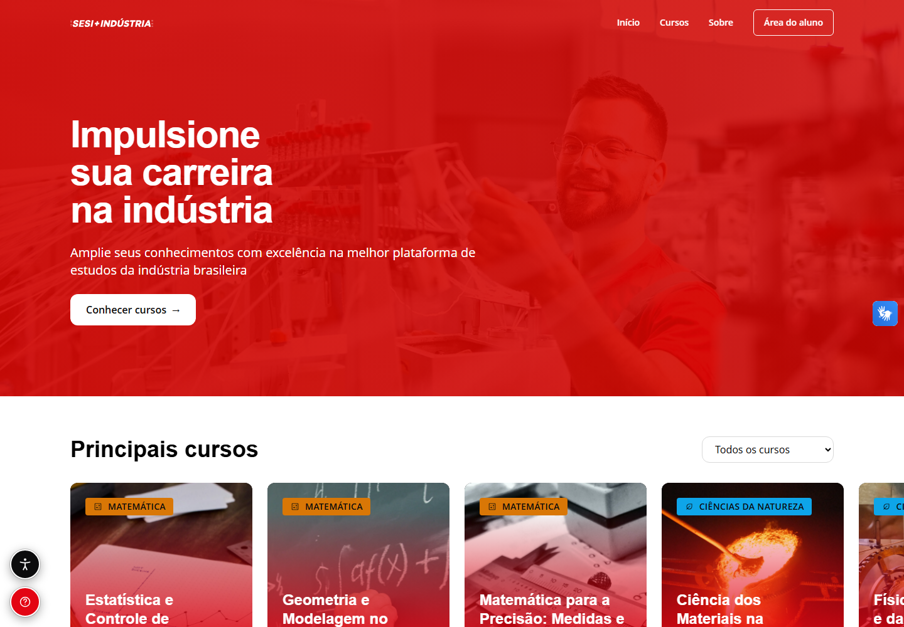
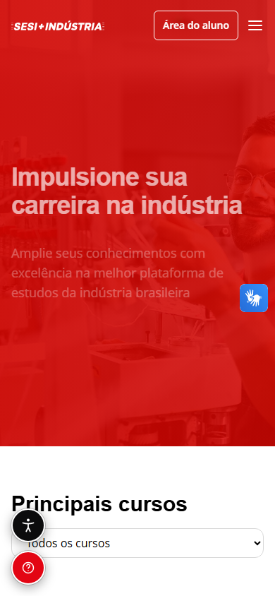

# Catálogo de Cursos — SESI Indústria


> Catálogo de cursos da **SESI Indústria** para consulta, busca e filtragem de ofertas,
> com página de detalhe, área do aluno, ambiente virtual de aprendizagem (AVA),
> painel administrativo integrado à API e página institucional.
> Interface construída a partir dos protótipos do Figma, com foco em acessibilidade,
> internacionalização e responsividade.
>
> **Produção:** https://frontend-ezequiel-reginos-projects.vercel.app · **API:** https://sesi-teste-dev.onrender.com
> **Repo:** `https://github.com/zecki1/sesi-teste-dev` (branch `main`)

---

## Funcionalidades

- **Catálogo completo** com 12 cursos, 5 categorias, 3 modalidades (Presencial, EAD e Semi-presencial) e 3 status.
- **Busca e filtros combináveis** por categoria, modalidade e status, com busca tolerante a acentos, contador de resultados, ordenação, paginação e limpeza de filtros.
- **Landing** com 6 cursos em destaque (Matemática e Ciências da Natureza), cards com capas em WebP, **sliders full-bleed** (4 cards + fração do 5º no desktop), card “Todos os cursos” e CTA final que abre o catálogo.
- **Detalhe do curso** com módulos e aulas, certificação, benefícios, acordeão “Sobre o curso”, depoimentos e **modal de matrícula** com turmas, data, dias, horário, modalidade e vagas.
- **Área do aluno** com login e cadastro demonstrativos, perfil sincronizado com o usuário local da API, matrículas, certificados, calendário de aulas gerado a partir das turmas e preferências de acessibilidade.
- **Gestão administrativa** de cursos, usuários, papéis, permissões e chamados. Em produção, a API exige uma sessão administrativa autenticada, protegida por cookie `HttpOnly`, `Secure` e com validade de oito horas.
- **Ajuda ao aluno** por formulário persistido na API, com captura de tela opcional anexada ao chamado, notificação para a equipe e confirmação ao aluno via Resend quando o serviço está configurado.
- **Calendário navegável** com eventos de aula e marcos persistidos de início e conclusão dos cursos; conclusão exibe um comprovante demonstrativo para impressão.
- **AVA** em `/area-do-aluno/curso/:slug`, em duas colunas, com introdução, seis módulos, busca, progresso e conteúdo.
- **Página de curso SCORM** em `/curso/:slug/scorm`, compartilhando hero, benefícios, módulos/FAQ, depoimentos, suporte e matrícula com cursos em blocos; textos e imagens por URL são configuráveis no admin.
- **Upload e player SCORM 1.2/2004** em `/curso/:slug/scorm/player`, com progresso persistente, preferências de acessibilidade sincronizadas com o AVA, um pacote ativo por curso, download do ZIP publicado e substituição validada; o player mantém o header e retorno aos detalhes.
- **Painel administrativo** para cursos, categorias e limite global de upload SCORM (20/50/80/100/200 MB; padrão 100 MB), com editor de módulos/aulas e blocos (texto, vídeo, imagem e quiz). A gestão de categorias permite criar, renomear, traduzir, trocar a cor do badge, reordenar e excluir categorias sem cursos vinculados; ao digitar um nome, a API sugere categorias parecidas para evitar duplicidade.
- **Fluxo interno de cursos** com Rascunho, Homologado e Publicado. Somente cursos publicados e dentro da data programada aparecem no catálogo; as datas de publicação, liberação de matrícula e disponibilização controlam a oferta.
- **Acessibilidade** com modal de ajustes, rolagem interna, filtros de visão, **slider de fonte em passos fixos**, modo dislexia, **VLibras opcional** e seletor de idioma.
- **Consentimento de cookies** persistido em `localStorage` e no cookie `sesi_cookies`; o banner não reaparece após a decisão.
- **Três idiomas** (PT-BR, EN-US, ES-ES) com detecção por fuso horário e persistência no perfil e no `localStorage`.
- **Página “Sobre”** com conteúdo institucional do SESI e vídeos reais do canal Sesi São Paulo.

---

## Screenshots do produto

As capturas de referência desktop e mobile ficam em [`docs/screenshots/`](./docs/screenshots/).
São geradas por E2E do Playwright com dados simulados, sem incluir informações pessoais ou depender
da API de produção. Para atualizar todas as páginas:

```bash
cd frontend
npm run e2e:screenshots
```

As capturas são imagens da viewport em Chromium. A home segue o modelo visual do README de referência;
os links abaixo abrem as demais páginas capturadas.

### Home

| Desktop | Mobile |
|---------|--------|
|  |  |

### Outras páginas

| Página | Desktop | Mobile |
|--------|---------|--------|
| Catálogo | [Ver captura](./docs/screenshots/catalogo-desktop.png) | [Ver captura](./docs/screenshots/catalogo-mobile.png) |
| Detalhe do curso | [Ver captura](./docs/screenshots/curso-detalhe-desktop.png) | — |
| Página SCORM | [Ver captura](./docs/screenshots/curso-scorm-desktop.png) | — |
| Área do aluno | [Ver captura](./docs/screenshots/area-do-aluno-desktop.png) | — |
| Administração de cursos | [Ver captura](./docs/screenshots/admin-cursos-desktop.png) | — |

---

## Documentação

| Documento | Descrição |
|-----------|-----------|
| [`docs/DECISOES.md`](./docs/DECISOES.md) | Registro de decisões técnicas, contexto e trade-offs |
| [`docs/USO_DE_IA.md`](./docs/USO_DE_IA.md) | Ferramentas de IA utilizadas, prompts e processo de revisão |
| [`docs/LIMITACOES.md`](./docs/LIMITACOES.md) | Limitações conhecidas, divergências e itens não concluídos |
| [`docs/screenshots/`](./docs/screenshots/) | Capturas desktop/mobile das principais páginas, geradas por Playwright |

---

## Setup rápido

**Pré-requisitos:** [.NET SDK 10+](https://dotnet.microsoft.com/download) e [Node.js 20+](https://nodejs.org/).

```bash
# Front-end e API
cd frontend
npm install
npm run dev                                # API em :5077 e Vite em :5173
```

O front-end usa `http://localhost:5077` como API padrão. Para apontar para outro ambiente, crie
`frontend/.env.local` com `VITE_API_URL=http://localhost:5077`. Se a porta `5173` estiver ocupada, o Vite pode abrir em `5174`; a API local também permite as origens `localhost:5174` e `127.0.0.1:5174` via CORS.
Os dois serviços também podem ser iniciados pelo back-end: execute `dotnet run --project backend/Sesi.Catalogo.Api --launch-profile http` na raiz do repositório. Em Development, esse comando inicia o Vite se ele ainda não estiver ativo; `npm run dev` faz o inverso, iniciando a API se necessário. Ambos verificam serviços locais já ativos para evitar iniciar uma segunda instância. Ao encerrar o processo que iniciou ambos, o serviço filho também é encerrado.
No modo de desenvolvimento, chamadas da API não são substituídas por dados simulados: catálogo, matrículas e progresso exigem que a API local esteja rodando.
Com a API iniciada, o health check local fica disponível em `http://localhost:5077/health`.
O Swagger/OpenAPI local fica em [`http://localhost:5077/swagger`](http://localhost:5077/swagger) enquanto a API está rodando. A interface Swagger é habilitada nos ambientes Development e Staging; não está exposta no ambiente Production.
O banco SQLite local (`catalogo.db`), os pacotes SCORM, chamados, usuários e marcos dos cursos ficam em arquivos locais; a pasta `backend/Sesi.Catalogo.Api/App_Data/` é ignorada pelo Git para não versionar uploads e dados de alunos.

### E-mail de suporte local

A chave `Resend:ApiKey` deve ser armazenada no User Secrets do projeto da API, nunca no frontend ou em arquivos versionados:

```powershell
dotnet user-secrets set "Resend:ApiKey" "<chave-do-resend>" --project backend/Sesi.Catalogo.Api
```

O destino padrão dos chamados é `zecki1@hotmail.com`; o remetente padrão é `SESI Indústria <noreply@zecki1.com.br>`. Se necessário, sobrescreva `Support:Email` e `Resend:FromEmail` com User Secrets ou variáveis de ambiente. O endereço de origem precisa estar verificado na conta Resend.

> **Limite de segurança:** as contas comuns podem cadastrar e validar senha com hash no armazenamento local da API em `Development`; a sessão e os papéis ainda são demonstrativos no `localStorage`, sem token nem identidade de produção. As contas de demonstração seguem sem senha por conveniência. As rotas administrativas de usuários, permissões, cursos internos e chamados estão disponíveis apenas quando a API roda em `Development`; a matriz configurada não constitui autorização para produção.

> **E2E:** na primeira vez, instale o navegador do Playwright com `npx playwright install chromium`.

### Contas de demonstração

| Perfil | Como entrar |
|--------|-------------|
| Aluno | `aluno@teste.com` (ou “Usar conta de teste”) |
| Administrador | `admin@sesindustria.com.br` |

> As duas contas acima entram sem senha e são exclusivas para demonstração. Contas de aluno comuns
> precisam de senha no cadastro/login local; senhas são armazenadas como hash no backend e nunca
> retornadas pela API. A sessão continua demonstrativa e client-side (`localStorage`), sem backend
> de identidade de produção. Contas legadas de aluno sem senha podem definir a senha no primeiro
> cadastro local; essa facilidade não deve ser exposta como autenticação de produção sem verificação
> de e-mail. O painel administrativo ainda usa a sessão demo.
> Ver [`docs/LIMITACOES.md`](./docs/LIMITACOES.md).

---

## Comandos principais

| Comando | O que faz |
|---------|-----------|
| `npm run dev` | Sobe o Vite e a API .NET local, iniciando somente os serviços que ainda não estiverem ativos |
| `npm run build` | Typecheck + build de produção (`dist/`) |
| `npm run preview` | Serve o build de produção localmente |
| `npm run typecheck` | `tsc --noEmit` |
| `npm test` | Testes unitários (Vitest) |
| `npm run test:coverage` | Unitários com cobertura (`coverage/`) |
| `npm run test:ui` | Vitest em interface gráfica |
| `npm run e2e` | Fluxos E2E (Playwright, Chromium) |
| `npm run e2e:a11y` | Testes de acessibilidade (axe) |
| `npm run e2e:ui` | Playwright em modo UI |
| `npm run perf:lighthouse` | Lighthouse CI em quatro rotas do build local |
| `npm run e2e:screenshots` | Gera screenshots desktop/mobile em `docs/screenshots/` |
| `dotnet run --project Sesi.Catalogo.Api --launch-profile http` | Sobe a API e o Vite (`backend/`) |
| `dotnet test` | Testes de integração da API (`backend/`) |

Os comandos de front-end rodam em `frontend/`; os de back-end, em `backend/`.
`npm run lint` não está disponível: o ESLint 10 ainda não é compatível com o TypeScript 7 usado no
projeto — a verificação estática é feita por `npm run typecheck`.

---

## Telas (rotas)

| Rota | Descrição |
|------|-----------|
| `/` | Landing: hero, cursos em destaque, diferenciais, depoimentos e CTA |
| `/catalogo` | Catálogo completo com busca, filtros, ordenação e paginação |
| `/curso/:slug` | Detalhe do curso, módulos, benefícios, acordeão e depoimentos |
| `/curso/:slug/scorm` | Página padronizada do curso SCORM, progresso e player |
| `/area-do-aluno` | Login modal e dashboard do aluno (perfil, matrículas, certificados, calendário) |
| `/area-do-aluno/curso/:slug` | AVA do curso: introdução, seis módulos, busca e progresso |
| `/admin/cursos` | CRUD de cursos, gestão de categorias, configuração do limite de upload e gestão do pacote SCORM ativo |
| `/sobre` | Página institucional com história, valores, pilares e vídeos |
| `*` | Página 404 |

---

## API

| Método | Endpoint | Descrição |
|--------|----------|-----------|
| `GET` | `/health` | Health check |
| `GET` | `/api/v1/cursos` | Lista cursos com busca, filtros, ordenação e paginação |
| `GET` | `/api/v1/cursos/{slug}` | Detalhe do curso com módulos e aulas |
| `POST` | `/api/v1/cursos` | Cria um curso no catálogo |
| `PUT` | `/api/v1/cursos/{slug}` | Atualiza metadados, módulos e aulas |
| `DELETE` | `/api/v1/cursos/{slug}` | Desativa o curso e libera o slug |
| `GET` | `/api/v1/cursos/{slug}/turmas` | Turmas com data, dias, horário, modalidade e vagas |
| `POST` | `/api/v1/matriculas` | Matricula o aluno em uma turma |
| `GET` | `/api/v1/matriculas?usuarioId=...` | Lista as matrículas do aluno |
| `GET` | `/api/v1/facetas` | Categorias, modalidades e status para os filtros |
| `GET` | `/api/v1/categorias` | Lista categorias com traduções e quantidade de cursos (admin) |
| `GET` | `/api/v1/categorias/similares?nome=...` | Sugere categorias com nome parecido para evitar duplicidade |
| `POST` | `/api/v1/categorias` | Cria categoria com cor, ordem e traduções |
| `PUT` | `/api/v1/categorias/{id}` | Atualiza a categoria |
| `DELETE` | `/api/v1/categorias/{id}` | Exclui categoria sem cursos vinculados |
| `GET` | `/api/v1/cursos/{slug}/progresso` | Progresso do aluno (header `X-Usuario-Id`) |
| `POST` | `/api/v1/sessoes-scorm` | Commit de sessão SCORM |
| `GET` | `/api/v1/sessoes-scorm?sessaoId=...` | Recupera sessão SCORM |
| `GET/PUT` | `/api/v1/scorm/configuracoes` | Consulta/atualiza o limite global de upload SCORM |
| `GET/PUT` | `/api/v1/scorm/paginas/{cursoSlug}` | Consulta/salva a configuração da página SCORM |
| `POST` | `/api/v1/scorm/pacotes` | Envia e valida um pacote SCORM ZIP |
| `GET` | `/api/v1/scorm/pacotes` | Lista pacotes ativos para o admin |
| `GET` | `/api/v1/scorm/pacotes/{cursoSlug}` | Consulta o pacote ativo do curso |
| `GET` | `/api/v1/scorm/pacotes/{id}/download` | Baixa o ZIP original do pacote ativo |
| `DELETE` | `/api/v1/scorm/pacotes/{cursoSlug}` | Remove o pacote ativo do curso |
| `GET/POST` | `/api/v1/scorm/progresso` | Consulta/persiste o progresso do player |

Parâmetros de `/api/v1/cursos`: `busca`, `categoria`, `modalidade`, `status`, `pagina`,
`tamanho` (máx. 48), `ordenar` (`nome`, `nome-desc`, `carga`, `carga-desc`, `recentes`) e
`destaque` (`true`/`false`). A documentação interativa está disponível em
[`http://localhost:5077/swagger`](http://localhost:5077/swagger) no ambiente local de desenvolvimento.

---

## Qualidade & Performance

| Métrica | Resultado |
|---------|-----------|
| Testes unitários | **14/14** passando (Vitest + Testing Library) |
| Testes E2E | **43/43** passando (Playwright, Chromium) — 26 fluxos + 6 verificações axe/tema + 3 estados de catálogo + 8 capturas de telas |
| Testes de API | **23/23** passando (xUnit + `WebApplicationFactory` + SQLite in-memory) |
| Acessibilidade (axe) | **0** violações `serious`/`critical` em `/`, `/catalogo`, detalhe do curso e página SCORM, nos temas claro e escuro |
| Typecheck | OK (`tsc --noEmit`) |
| Build | OK · JS ~897 kB · CSS ~86 kB (aviso de chunk > 500 kB) |
| Performance | Lighthouse CI: 3 execuções por rota; medianas de 83 (home), 72 (catálogo), 64 (detalhe) e 66 (SCORM). Catálogo e detalhe ficaram abaixo do limite de aviso 80; [relatório](./docs/performance/lighthouse-2026-10-23.md) |

---

## Acessibilidade

- **WCAG 2.1 A/AA** verificada com `@axe-core/playwright` em `/`, `/catalogo`, detalhe do curso e página SCORM (`npm run e2e:a11y`).
- **Sidebar de acessibilidade** com filtros de visão (monocromia, protanopia, deuteranopia e tritanopia), tamanho de fonte, modo dislexia (OpenDyslexic) e restauração dos padrões.
- **VLibras** integrado para tradução em Libras; fica oculto enquanto o modal de acessibilidade está aberto para não sobrepor os controles.
- **Idioma** PT/EN/ES sincronizado com o atributo `lang` do `<html>`, persistido no perfil e no `localStorage`; a primeira visita detecta o idioma pelo fuso horário.
- **Login modal** com `aria-modal`, foco gerenciado, fechamento por `Esc` e clique no backdrop.
- **Foco visível** (`focus-visible`) em todos os controles interativos, navegação por teclado e landmarks semânticos.
- **Movimento** reduzido respeitado por Lenis, AOS e GSAP via `prefers-reduced-motion`.

---

## Design

- **Fonte visual:** protótipos do Figma — landing `6017-342`, detalhe do curso `6017-707` e AVA `6017-1042`.
- **Cores:** vermelho SESI `#D00602`, destaque `#E30513`, bege `#FCD19C`, preto `#0C0C0D` e cinza `#D9D9D9`.
- **Tipografia:** Open Sans como fonte principal (com fallback para a fonte do sistema), variando o peso entre títulos e textos.
- **Componentes:** Tailwind CSS 4 + componentes próprios no padrão shadcn/ui, sem dependência de Radix.
- **Movimento:** Lenis para rolagem suave, AOS para revelações e GSAP para a entrada do hero.
- **Capas dos cursos:** 12 SVGs gerados localmente em `frontend/public/cursos/`.

---

## Estrutura do projeto

```
repo/
├─ frontend/
│  ├─ e2e/                    # Playwright: fluxos, acessibilidade e fixtures
│  ├─ public/
│  │  ├─ cursos/              # Capas SVG dos cursos
│  │  └─ fonts/               # OpenDyslexic (modo dislexia)
│  └─ src/
│     ├─ app/                 # Rotas e App
│     ├─ components/          # Layout, UI e acessibilidade
│     ├─ features/            # landing, catalogo, curso, aluno, ava, admin, sobre
│     ├─ hooks/               # Hooks de dados e UI
│     ├─ i18n/                # pt-BR, en-US e es-ES
│     ├─ lib/                 # API, auth, idioma e utilitários
│     └─ styles/              # Tokens e estilos globais
├─ backend/
│  ├─ Sesi.Catalogo.Api/            # Endpoints, Swagger e configuração
│  ├─ Sesi.Catalogo.Domain/         # Entidades, DTOs e abstrações
│  ├─ Sesi.Catalogo.Infrastructure/ # EF Core, repositórios e seed
│  └─ Sesi.Catalogo.Tests/          # Testes de integração
├─ docs/                      # Decisões, uso de IA e limitações
├─ .githooks/commit-msg       # Validação do padrão de commit
├─ frontend/playwright.config.ts
└─ frontend/vitest.config.ts
```

---

## Stack

| Camada | Tecnologia |
|--------|-----------|
| Front-end | Vite 8 + React 19 + TypeScript strict |
| Estilo | Tailwind CSS 4 + componentes próprios no padrão shadcn/ui |
| Rotas e dados | React Router 7 + TanStack Query 5 |
| i18n | i18next + react-i18next (PT-BR, EN-US, ES-ES) com detecção por fuso horário |
| Movimento | Lenis + AOS + GSAP |
| Ícones | SVGs locais + `react-icons` (`fa`) para categorias sem ícone próprio |
| Back-end | ASP.NET Core 10 + Entity Framework Core 10 |
| Banco | SQLite (desenvolvimento) e PostgreSQL (produção), via `Database__Provider` |
| Documentação da API | OpenAPI/Swagger |
| Testes | Vitest + Testing Library · Playwright + axe · xUnit |
| Deploy | Vercel (front-end) + Render (API e PostgreSQL) |

---

## Decisão de teste

- **Vitest + Testing Library** para lógica pura e componentes de UI em `jsdom`, sem carregar CSS.
  Cobre o store do banner, a persistência do consentimento de cookies e a configuração da página SCORM;
  roda rápido e sem backend.
- **Playwright** para fluxos reais com **interceptação de rede** e fixtures capturadas da API
  (`e2e/support/mock-api.ts`), portanto os E2E **não exigem o back-end no ar**. Os 26 fluxos cobrem
  landing, catálogo (busca, filtros, vazio), detalhe, AVA, página SCORM, matrícula, login, tema, fonte,
  VLibras, cookies, trava de rolagem dos modais, cards com capa WebP, badges coloridos/uppercase e ícone
  de categoria, geometria dos sliders full-bleed (4 cards + fração do 5º em 1440 px), clique e drag dos
  sliders de cursos/depoimentos, status do menu do AVA, slider e menu mobile.
- **axe-core** nos testes de acessibilidade das rotas `/`, `/catalogo`, detalhe e página SCORM; a suíte
  falha em violações `serious` ou `critical`.
- **xUnit + WebApplicationFactory** no backend, com SQLite in-memory e testes de contrato dos
  endpoints, filtros, CORS, 404 e SCORM.

---

## Branches & Workflow Git

- Branches: `main` (produção) e `develop` (integração). Features saem de `develop`.
- **Padrão de commit (Conventional Commits):**

  ```
  <tipo>(<escopo>)?: <descrição no imperativo>
  ```

  **Tipos:** `feat`, `fix`, `test`, `docs`, `design`, `ops`, `backend`, `chore`, `refactor`,
  `perf`, `style`, `ci`, `build`.

  ```text
  feat(catalogo): adiciona filtros combinados
  fix(a11y): corrige sobreposição do VLibras no modal
  test: cobre a detecção de idioma por fuso horário
  docs: padroniza o README
  ```

- **Hook local** que valida a mensagem (sem dependências). Ative uma vez por clone:

  ```bash
  git config core.hooksPath .githooks
  ```

  O hook está em `.githooks/commit-msg` e rejeita mensagens fora do padrão
  (commits `Merge`/`Revert`/`fixup!`/`squash!` passam direto).

---

## Deploy

### Front-end (Vercel)

- Projeto com `rootDirectory: frontend`, build `npm run build` e output `dist/`.
- `vercel.json` define os rewrites de SPA para `/index.html`.
- `frontend/.env.production` aponta `VITE_API_URL` para a API no Render.

### Back-end (Render)

- Web Service com `rootDirectory: backend` e runtime Docker (`Dockerfile`).
- PostgreSQL gerenciado pelo Render, configurado por variáveis de ambiente:

  ```env
  Database__Provider=Npgsql
  ConnectionStrings__Catalogo=Host=...;Database=...;Username=...;Password=...
  Cors__AllowedOrigins__0=https://frontend-ezequiel-reginos-projects.vercel.app
  Cors__AllowedOrigins__1=https://frontend-lovat-iota-wvh45bt95b.vercel.app
  Gestao__Admin__Email=admin@sesindustria.com.br
  Gestao__Admin__Senha=<segredo-forte-configurado-no-Render>
  Gestao__DiretorioDados=/var/data/gestao
  Scorm__Root=/var/data/scorm
  ```

- O banco é criado com `EnsureCreated()` e populado pelos seeders na inicialização.
- Em desenvolvimento, o padrão é SQLite (`Data Source=catalogo.db`), sem configuração extra.
- Configure `Gestao__Admin__Senha` como segredo no painel do Render; não use a senha demonstrativa nem a versione no repositório. O e-mail configurado precisa corresponder a um usuário ativo com papel `Administrador`.
- Anexe um disco persistente do Render montado em `/var/data`. A gestão e os pacotes/progresso SCORM ainda usam arquivos; sem o disco, esses dados podem ser perdidos em novos deploys ou reinicializações.
- `Cors__AllowedOrigins__0` deve conter a origem exata do front-end publicado. Use `__1`, `__2`… para mais origens (produção e previews) ou uma única chave com a lista separada por vírgula. A API rejeita curingas de origem fora de Development para impedir que outros sites compartilhem a sessão administrativa. Cada nova URL de preview da Vercel precisa ser adicionada explicitamente: o domínio com hash muda a cada deploy.
- No log de inicialização, a API imprime `[CORS] Origens permitidas: ...`. Se a origem do frontend não estiver nessa lista, o navegador bloqueia a resposta mesmo com HTTP 200.

---

## Links

- **Produção:** https://frontend-ezequiel-reginos-projects.vercel.app
- **API:** https://sesi-teste-dev.onrender.com
- **Repositório:** https://github.com/zecki1/sesi-teste-dev
- **Decisões:** [`docs/DECISOES.md`](./docs/DECISOES.md)
- **Uso de IA:** [`docs/USO_DE_IA.md`](./docs/USO_DE_IA.md)
- **Limitações:** [`docs/LIMITACOES.md`](./docs/LIMITACOES.md)
- **Autor:** Ezequiel Regino Monção — [GitHub](https://github.com/zecki1) · [LinkedIn](https://www.linkedin.com/in/ezequiel-moncao)

---

## Licença

Projeto desenvolvido para o processo seletivo do **SESI Indústria — Desenvolvedor de Sistemas I**.
Uso educacional e restrito à avaliação. Todos os direitos reservados © Ezequiel Regino Monção.
